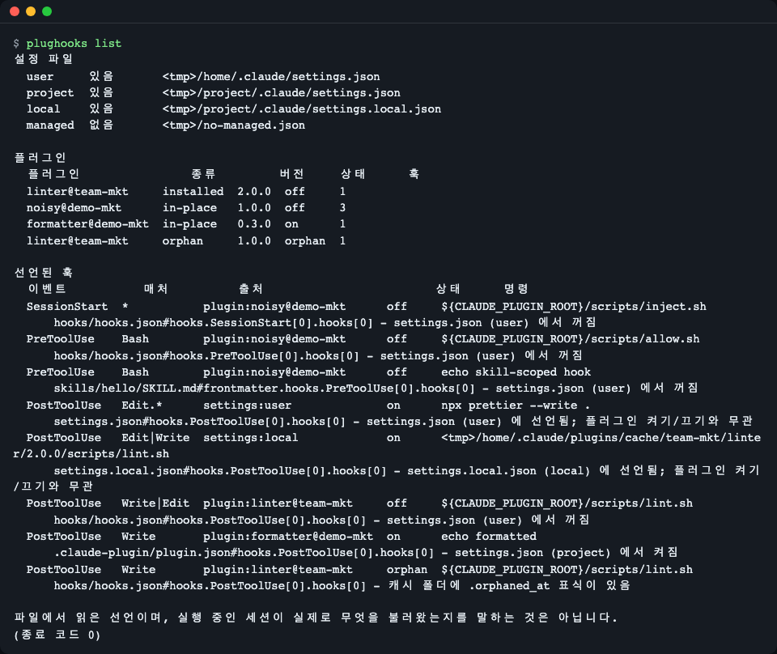
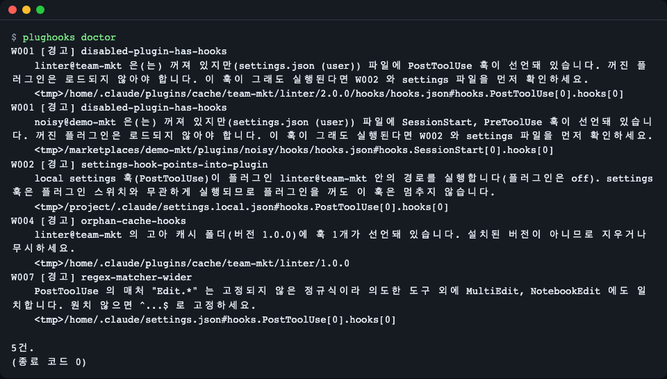
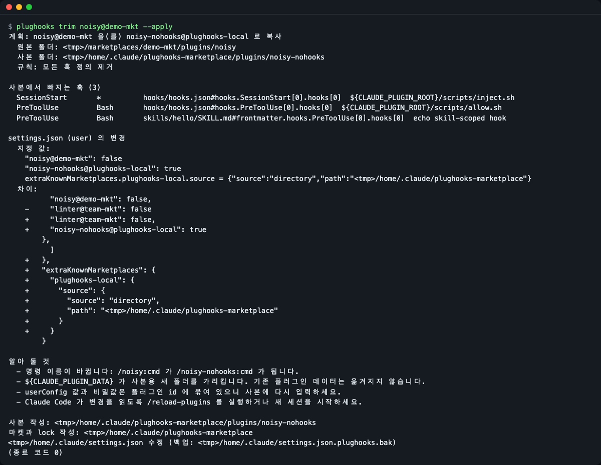
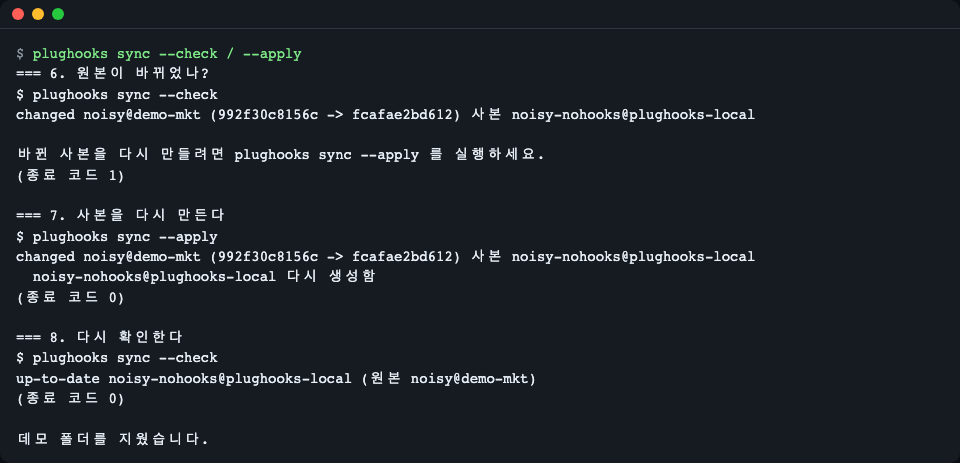
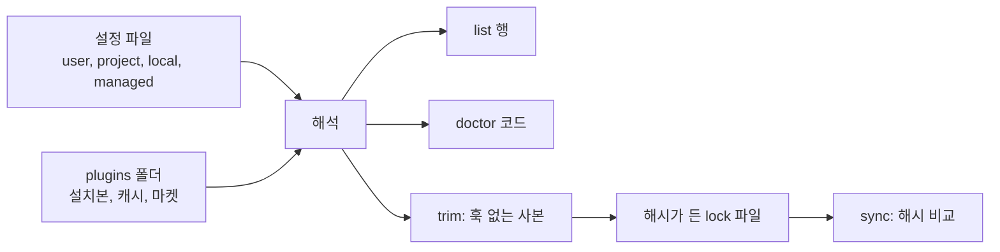

# plughooks

[English](README.md) | **한국어**

Claude Code 훅이 어느 설정 파일·어느 플러그인(꺼진 플러그인과 고아 캐시 폴더 포함)에서 선언됐는지 찾아 주고, 플러그인의 스킬·명령은 그대로 둔 채 훅만 뺀 로컬 사본을 만들어 관리합니다.


*내장 연습용 트리에서 `plughooks list` 를 실행한 화면: 선언된 훅마다 출처 파일, JSON 경로, 켜짐·꺼짐 이유가 보입니다.*

plughooks 는 파일을 읽기만 합니다. 디스크와 설정에 선언된 내용을 보고할 뿐, 실행 중인 Claude Code 세션이 실제로 무엇을 불러왔는지는 단정하지 않습니다.

## 이런 분께
- 플러그인을 여러 개 쓰는데, 계속 실행되는 훅이 어느 파일에서 왔는지 알고 싶을 때
- 플러그인을 껐는데도 훅이 도는 것 같아서, 설정 훅이나 남은 캐시 폴더 때문인지 확인하고 싶을 때
- 플러그인의 스킬·명령은 쓰고 싶지만 훅은 싫어서, 원본 업데이트를 따라가는 훅 없는 로컬 사본이 필요할 때

## 설치
Node.js 22 이상([nodejs.org](https://nodejs.org/en/download))과 git 이 필요합니다. 그 밖의 시스템 패키지는 필요 없습니다.

```bash
git clone https://github.com/LeeGyeongPil/plughooks.git
cd plughooks
npm install
npm run build
npm install -g .      # plughooks 명령을 PATH 에 둡니다
plughooks --version
```
```text
0.1.4
```

전역 설치 없이 clone 한 폴더에서 `node dist/cli.js <명령>` 으로 실행해도 됩니다.

## 빠르게 시작하기
먼저 목(mock) 트리로 해 보세요. 연습용 데모는 가짜 `~/.claude` 를 임시 폴더에 복사해서 쓰며 실제 폴더는 건드리지 않습니다.

```bash
npm run demo -- --lang ko
```

`list`, `doctor`, `trim --apply`, 원본 수정, `sync --check`, `sync --apply` 를 차례로 보여 줍니다. 첫 단계는 맨 위 그림과 같습니다. 내 환경에서는 이렇게 실행합니다.

```bash
plughooks list
```

읽는 법: **플러그인** 표는 플러그인별 상태(`on`, `off`, `orphan`)와 훅 개수를, **선언된 훅** 은 훅마다 한 줄씩 이벤트·매처·출처(`settings:user`, `plugin:이름@마켓` 등)·상태·명령을 보여 주고, 그 아래 줄에 파일·JSON 경로·상태의 이유가 나옵니다.

## 사용법

| 명령 | 하는 일 | 예 |
|---|---|---|
| `list` | 선언된 모든 훅을 출처·JSON 경로·상태·이유와 함께 표시 | `plughooks list --event PostToolUse` |
| `doctor` | 수상한 구성을 고정 코드 `W001`~`W011` 로 보고 | `plughooks doctor --strict` |
| `trim <이름@마켓>` | 훅 없는 플러그인 사본 계획(`--apply` 면 실제 생성) | `plughooks trim noisy@demo-mkt --apply` |
| `sync` | 내용 해시로 원본 변경 감지, `--apply` 로 사본 재생성 | `plughooks sync --check` |

공통 옵션: `--json`(기계 판독, 언어와 무관), `--lang en|ko`, `--claude-dir`, `--plugins-dir`, `--project`, `--managed-settings`. `--apply` 를 주지 않으면 아무것도 쓰지 않습니다.

### 훅이 어디서 왔는지 찾기
`plughooks doctor` 가 흔한 원인을 짚어 줍니다. 예: W001(플러그인은 꺼졌는데 파일에 훅이 선언됨), W002(설정 훅이 플러그인 안 경로를 실행해서 플러그인을 꺼도 멈추지 않음), W004(고아 캐시 폴더), W007(`Edit.*` 처럼 앵커 없는 정규식 매처).


*연습용 트리에서 `plughooks doctor` 를 실행한 화면.*

### 훅 없는 플러그인 사본 만들기
`--apply` 없이 `trim` 을 실행하면 아무것도 쓰지 않고 계획만 보여 줍니다. `--apply` 를 주면 플러그인을 로컬 디렉터리 마켓(`plughooks-local`)에 복사하고, 사본에서 모든 훅 정의(`hooks/hooks.json`, `plugin.json` 의 `hooks`, 프런트매터 훅)를 지우고, 설정 파일을 `settings.json.plughooks.bak` 로 백업한 뒤 원본은 끄고 사본은 켭니다.

```bash
plughooks trim noisy@demo-mkt                              # 미리보기
plughooks trim noisy@demo-mkt --apply                      # 모든 훅 제거
plughooks trim noisy@demo-mkt --drop-events PreToolUse --apply   # 일부 이벤트만 제거
```

`--drop-events` 이름은 대소문자를 구분해 검사합니다. `pretooluse` 나 `Bogus` 는 종료 2 와 함께 "혹시 ...?" 제안, 그리고 플러그인이 실제로 선언한 이벤트 목록을 보여 줍니다. 규칙상 제거되는 훅이 0개면 `--apply` 는 종료 2 로 멈추고(사본이 원본과 같은데 원본만 꺼지기 때문), 그래도 진행하려면 `--allow-empty` 를 더합니다. 이미 plughooks 사본인 플러그인은 다시 trim 할 수 없으니 원본을 trim 하거나 `sync --apply` 를 쓰세요.


*연습용 데모의 `trim --apply`: 사본에서 훅 3개 제거, 설정 변경, 이후 알아둘 점.*

알아둘 점(도구도 출력합니다): 명령 이름이 바뀌고(`/noisy:cmd` → `/noisy-nohooks:cmd`), `${CLAUDE_PLUGIN_DATA}` 가 새 폴더를 가리키며, `userConfig` 값은 다시 입력해야 하고, `/reload-plugins` 나 새 세션이 필요합니다.

### trim 되돌리기
아직 `untrim` 명령은 없습니다. 손으로 되돌리는 방법:
1. 설정 파일을 백업에서 복원합니다. 백업은 설정 파일 옆에 `settings.json.plughooks.bak`, `.bak.1`, `.bak.2` ... 로 쌓이며(기존 백업을 덮어쓰지 않으므로 trim 직전 것을 고르세요), 직접 고친다면 `enabledPlugins["<이름>@<마켓>"]` 을 다시 `true` 로, `enabledPlugins["<이름>-nohooks@plughooks-local"]` 은 지웁니다.
2. 다른 사본이 없다면 설정 파일의 `extraKnownMarketplaces.plughooks-local` 도 지웁니다.
3. 사본 폴더(기본 `<claude 폴더>/plughooks-marketplace/plugins/<이름>-nohooks`), 마켓 폴더의 `plughooks-lock.json` 항목, `.claude-plugin/marketplace.json` 의 `plugins` 항목(`source` 가 `./plugins/<이름>-nohooks` 인 것)을 지웁니다. 남는 사본이 없으면 `plughooks-marketplace` 폴더 전체를 지워도 됩니다.
4. `/reload-plugins` 를 실행하거나 새 세션을 시작합니다.

### 사본을 최신으로 유지하기
```bash
plughooks sync --check     # 종료 코드 0 최신, 1 원본 변경됨
plughooks sync --apply     # 바뀐 사본 재생성
```
사본 폴더를 지웠는데 `plughooks-lock.json` 항목이 남아 있으면 `sync --check` 가 `copy-missing`(종료 코드 1)으로 알리고 `sync --apply` 가 폴더를 다시 만듭니다. `doctor` 는 원본이 바뀐 경우와 사본이 없는 경우를 모두 `W010` 으로 알립니다.
```text
changed noisy@demo-mkt (992f30c8156c -> fcafae2bd612) 사본 noisy-nohooks@plughooks-local

바뀐 사본을 다시 만들려면 plughooks sync --apply 를 실행하세요.
(종료 코드 1)
```


*원본이 바뀐 뒤: `sync --check` 는 1, `sync --apply` 가 재생성, 다시 `--check` 하면 0.*

### 경고 코드
`doctor` 가 내는 고정 코드입니다(`--json` 에도 들어 있음). `--strict` 는 경고가 하나라도 있으면 종료 1 입니다.

| 코드 | 이름 | 뜻 | 다음에 볼 것 |
|---|---|---|---|
| `W001` | disabled-plugin-has-hooks | 플러그인은 꺼졌는데 파일에 훅이 선언됨 | 그래도 훅이 돈다면 `W002` 와 설정 파일을 확인 |
| `W002` | settings-hook-points-into-plugin | 설정 훅이 플러그인 안 경로를 실행함 | 설정 훅은 플러그인 스위치와 무관하니 그 설정 항목을 수정 |
| `W003` | plugin-permission-hook | 켜진 플러그인이 `PreToolUse` 또는 `PermissionRequest` 훅을 선언함 | 스크립트를 검토(권한 결정에 관여할 수 있음) |
| `W004` | orphan-cache-hooks | 설치본이 아닌 캐시 폴더가 훅을 선언함 | 폴더를 지우거나 무시 |
| `W005` | same-name-plugins | 켜진 플러그인들이 같은 매니페스트 이름을 씀 | 하나만 `hooks.json` 훅을 등록하니 이름을 바꾸거나 하나를 끔 |
| `W006` | hooks-globally-disabled | `disableAllHooks` 또는 `allowManagedHooksOnly` 가 true | 선언과 상관없이 훅이 줄거나 꺼짐 |
| `W007` | regex-matcher-wider | `Edit.*` 처럼 앵커 없는 정규식 매처 | 다른 도구도 맞으니 원치 않으면 `^...$` 로 고정 |
| `W008` | hooks-json-missing-wrapper | `hooks/hooks.json` 에 `{"hooks": ...}` 래퍼가 없음 | plughooks 는 읽었지만 Claude Code 가 읽도록 래퍼를 씌움 |
| `W009` | install-record-unrecognized | `installed_plugins.json` 형식을 모름 | 마켓과 캐시에서 대신 읽었음 |
| `W010` | trimmed-copy-stale | 사본의 원본이 바뀌었거나 사본 폴더가 지워짐(`copy-missing`) | `plughooks sync --apply` 실행 |
| `W011` | unhandled-hook-location | plughooks 가 해석하지 않는 훅 관련 위치(hooks module 키, 없는 훅 파일, 객체가 아닌 설정 `hooks`, 플로 스타일 프런트매터) | 상세를 읽기. hooks module 키·플러그인 폴더 밖을 가리키는 훅 파일 경로·플로 스타일 프런트매터가 있는 플러그인은 `trim` 이 종료 3 으로 거부하고 아무것도 쓰지 않음. 플러그인 폴더 안의 없는 파일을 가리키는 훅 경로는 보고만 하고 `trim` 은 그대로 진행하며 사본에서 그 참조를 지움. 객체가 아닌 설정 `hooks` 는 보고만 하고 `trim` 을 멈추지 않음 |

## 설정
| 설정 | 뜻 |
|---|---|
| `--lang en\|ko` / `PLUGHOOKS_LANG` | 출력 언어. 순서는 `--lang`, `PLUGHOOKS_LANG`, `LC_ALL`, `LC_MESSAGES`, `LANG`, 한국어가 아니면 영어 |
| `CLAUDE_CONFIG_DIR` | 읽기 전용: Claude 설정 폴더(기본 `~/.claude`), `--claude-dir` 가 우선 |
| `CLAUDE_CODE_PLUGIN_CACHE_DIR` | 읽기 전용: plugins 폴더(기본 `<claude 폴더>/plugins`), `--plugins-dir` 가 우선 |
| `--managed-settings 파일` | 읽을 managed 설정 파일(절대 쓰지 않음). 기본 경로는 문서를 근거로 한 값 |

API 키도 네트워크도 필요 없습니다. 연습용 데모는 목 트리라 플러그인이 모두 가짜이고, 실제 모드는 내 폴더를 읽으며 `--apply` 를 주면 사본을 쓰고 백업 후 설정을 고칩니다.

종료 코드: `0` 정상, `1` `--strict` 경고 있음 또는 sync 필요, `2` 사용법·입력 오류, `3` 안전상 거부.

## 동작 원리

1. 설정 4계층과 plugins 폴더를 읽습니다.
2. 훅마다 출처 파일·JSON 경로·상태·이유를 해석합니다.
3. `list` 는 그 행을 보여 주고 `doctor` 는 수상한 패턴을 고정 코드로 바꿉니다.
4. `trim` 은 플러그인을 복사해 훅 정의를 지우고 내용 해시가 든 lock 파일을 씁니다.
5. `sync` 는 해시를 현재 원본과 비교하고, 요청하면 사본을 다시 만듭니다.

## 언제 쓰나
- 잘 맞는 경우: 훅이 어디에 선언됐는지 근거가 필요할 때, 원본을 따라가는 훅 없는 사본이 필요할 때
- 다른 방법: 플러그인을 끄려면 Claude Code 자체 플러그인 명령([플러그인 문서](https://code.claude.com/docs/en/plugins)), 훅을 직접 작성·관리하려면 [훅 문서](https://code.claude.com/docs/en/hooks). plughooks 는 훅을 실행하지 않고, 실행 중인 세션이 무엇을 불러왔는지도 판단하지 않습니다.

## 자주 겪는 문제
| 증상 | 원인 | 해결 |
|---|---|---|
| `list` 에 플러그인이 없음 | 설정 폴더가 다름 | `--claude-dir` 를 주거나 `CLAUDE_CONFIG_DIR` 설정 |
| `W009` | `installed_plugins.json` 형식을 모름 | 마켓과 캐시에서 대신 읽습니다. 출력이 완전한지 확인 |
| `오류: 알 수 없는 플러그인 ...` (종료 2) | 그 id 가 플러그인 목록에 없음 | `plughooks list` 의 id 를 그대로 복사 |
| `trim --drop-events X` 가 종료 2 | 모르는 이벤트 이름이거나 대소문자 오류, 또는 제거될 훅이 0개 | 제안된 이름(예: `PreToolUse`)을 쓰거나 `--allow-empty` 추가 |
| `trim` 이 종료 3 | 안전 검사가 쓰기를 거부함(예: 지원하지 않는 훅 형식) | 메시지를 읽고 입력을 고치거나 `--no-settings` 사용 |
| 한국어 표 열이 어긋남 | 정렬이 표시 폭이 아니라 글자 수 기준 | `--lang en` 또는 `--json` 사용 |

### 한계

설치된 플러그인 파일 형식은 공개 문서와 이슈 보고를 근거로 하며 모든 실제 설치를 확인한 것은 아닙니다. 프런트매터는 블록 스타일 YAML 만 읽습니다. 아직 지원하지 않는 것(기껏해야 경고): hooks module, `--plugin-dir` 로 불러온 플러그인(`@inline`), `@synced` 플러그인, `--add-dir`·`--settings` 의 훅. 플러그인이 선언한 파일만 읽으며 `claude` 를 실행하지 않습니다.

## 개발·기여
```bash
npm install
npm test
```
버그·제안은 이슈로 남겨 주세요. 변경 기록은 [CHANGELOG.md](CHANGELOG.md).

## 라이선스
MIT. 테스트와 데모는 만들어 낸 가짜 데이터만 씁니다.
