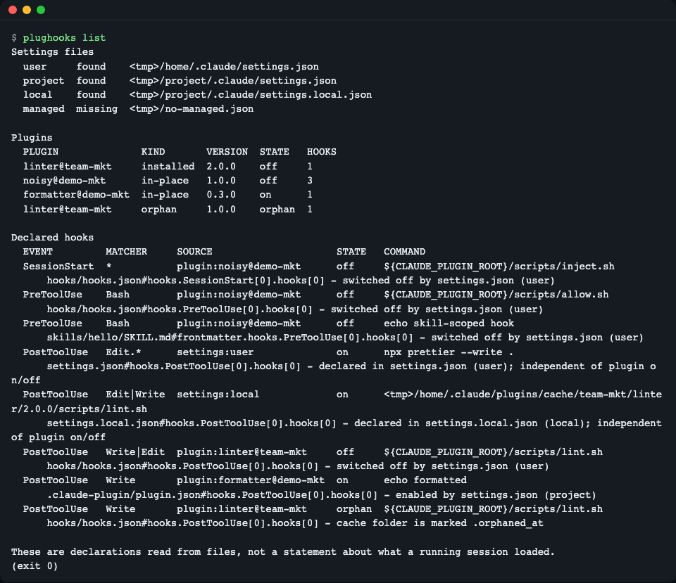
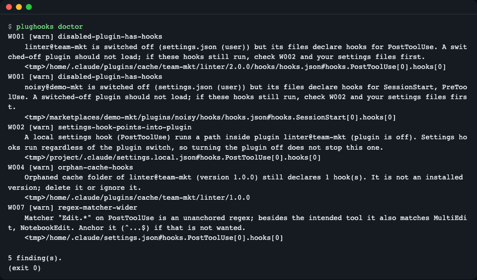
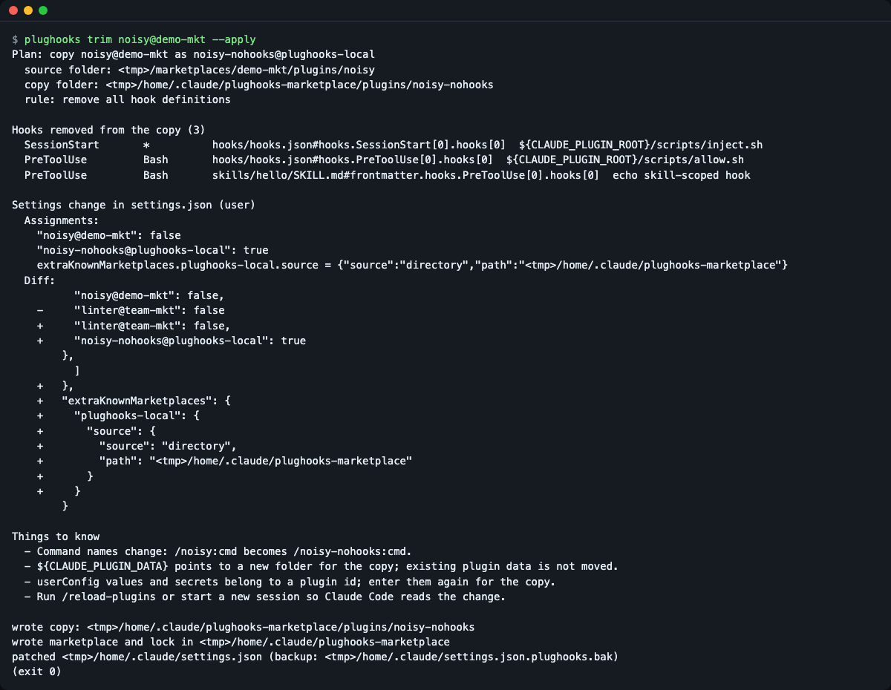
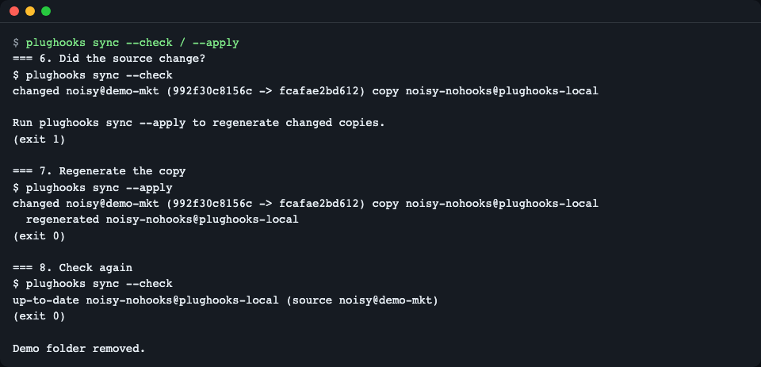
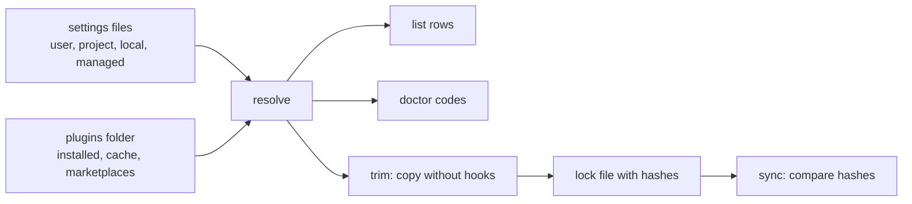

# plughooks

**English** | [한국어](README.ko.md)

Find out which settings file or plugin declares each Claude Code hook (including switched-off plugins and orphaned cache folders), then keep a hook-free local copy of a plugin while leaving its skills and commands in place.


*`plughooks list` on the built-in practice tree: each declared hook, the file and JSON path it comes from, and why it is on or off.*

plughooks only reads files. It reports what is declared on disk and in settings; it does not claim what a running Claude Code session actually loaded.

## Who it is for
- You use several Claude Code plugins and want to know which file a hook that keeps firing comes from.
- You switched a plugin off, but its hooks seem to still run, and you want to rule out settings hooks and leftover cache folders.
- You like a plugin's skills and commands but not its hooks, and want a local copy without hooks that follows upstream updates.

## Install
Requires Node.js 22 or newer ([nodejs.org](https://nodejs.org/en/download)) and git. No extra system packages are needed.

```bash
git clone https://github.com/LeeGyeongPil/plughooks.git
cd plughooks
npm install
npm run build
npm install -g .      # puts `plughooks` on your PATH
plughooks --version
```
```text
0.1.4
```

Or skip the global install and run `node dist/cli.js <command>` from the clone.

## Quick start
Try it on a mock tree first. The practice demo copies a fake `~/.claude` into a temporary folder and never touches your real one.

```bash
npm run demo -- --lang en
```

It walks through `list`, `doctor`, `trim --apply`, an upstream edit, `sync --check` and `sync --apply`. The first step looks like the picture at the top. Against your real setup, run:

```bash
plughooks list
```

Read it like this: the **Plugins** table shows each plugin's state (`on`, `off`, `orphan`) and hook count; **Declared hooks** shows one row per hook with the event, matcher, source (`settings:user`, `plugin:name@market`, ...), state, command, and below it the file, JSON path and the reason for the state.

## Usage

| Command | What it does | Example |
|---|---|---|
| `list` | Show every declared hook with source, JSON path, state and reason | `plughooks list --event PostToolUse` |
| `doctor` | Report suspicious setups with stable codes `W001`-`W011` | `plughooks doctor --strict` |
| `trim <name@market>` | Plan (or with `--apply`, build) a hook-free copy of a plugin | `plughooks trim noisy@demo-mkt --apply` |
| `sync` | Detect upstream changes by content hash; `--apply` regenerates the copies | `plughooks sync --check` |

Common options: `--json` (machine-readable, language neutral), `--lang en|ko`, `--claude-dir`, `--plugins-dir`, `--project`, `--managed-settings`. Everything is read-only unless you pass `--apply`.

### Find where a hook comes from
`plughooks doctor` points at likely causes, for example W001 (plugin is off but its files declare hooks), W002 (a settings hook runs a path inside a plugin, so the plugin switch does not stop it), W004 (orphaned cache folder) and W007 (an unanchored regex matcher such as `Edit.*`).


*`plughooks doctor` on the practice tree.*

### Make a hook-free copy of a plugin
Without `--apply`, `trim` writes nothing and shows the plan. With `--apply` it copies the plugin into a local directory marketplace (`plughooks-local`), removes every hook definition from the copy (`hooks/hooks.json`, `hooks` in `plugin.json`, frontmatter hooks), backs up your settings file as `settings.json.plughooks.bak`, switches the original off and the copy on.

```bash
plughooks trim noisy@demo-mkt                              # dry run
plughooks trim noisy@demo-mkt --apply                      # drop all hooks
plughooks trim noisy@demo-mkt --drop-events PreToolUse --apply   # drop only some events
```

`--drop-events` names are checked (case-sensitive). `pretooluse` or `Bogus` exits 2 with "Did you mean ...?" and the events the plugin actually declares. If a rule would remove 0 hooks, `--apply` exits 2 (the copy would equal the original while the original is switched off); add `--allow-empty` to go ahead anyway. A plugin that is itself a plughooks copy cannot be trimmed again: trim the original, or run `sync --apply`.


*`trim --apply` in the practice demo: three hooks removed from the copy, the settings change, and the things to know afterwards.*

Things to know (also printed by the tool): command names change (`/noisy:cmd` becomes `/noisy-nohooks:cmd`), `${CLAUDE_PLUGIN_DATA}` points to a new folder, `userConfig` values must be entered again, and you need `/reload-plugins` or a new session.

### Undo a trim
There is no `untrim` command yet. To go back by hand:
1. Restore the settings file from its backup. Backups sit next to it: `settings.json.plughooks.bak`, then `.bak.1`, `.bak.2`, ... (an existing backup is never overwritten, so pick the one from before your trim). Or edit by hand: set `enabledPlugins["<name>@<market>"]` back to `true`, and remove `enabledPlugins["<name>-nohooks@plughooks-local"]`.
2. If you have no other copies, remove `extraKnownMarketplaces.plughooks-local` from the settings file.
3. Delete the copy folder (default `<claude dir>/plughooks-marketplace/plugins/<name>-nohooks`), its entry in `plughooks-lock.json`, and its entry in `.claude-plugin/marketplace.json` (the `plugins` item whose `source` is `./plugins/<name>-nohooks`) in the marketplace folder. If no other copies remain, delete the whole `plughooks-marketplace` folder.
4. Run `/reload-plugins` or start a new session.

### Keep the copy current
```bash
plughooks sync --check     # exit 0 up to date, exit 1 source changed
plughooks sync --apply     # regenerate changed copies
```
If you deleted a copy folder but its `plughooks-lock.json` entry is still there, `sync --check` reports `copy-missing` (exit 1) and `sync --apply` rebuilds the folder. `doctor` flags both a changed source and a missing copy as `W010`.
```text
changed noisy@demo-mkt (992f30c8156c -> fcafae2bd612) copy noisy-nohooks@plughooks-local

Run plughooks sync --apply to regenerate changed copies.
(exit 1)
```


*After the source changes: `sync --check` exits 1, `sync --apply` regenerates, the next `--check` exits 0.*

### Warning codes
`doctor` prints these stable codes (`--json` includes them too). `--strict` makes any warning exit 1.

| Code | Name | Meaning | What to check next |
|---|---|---|---|
| `W001` | disabled-plugin-has-hooks | Plugin is switched off but its files declare hooks | If those hooks still run, look at `W002` and your settings files |
| `W002` | settings-hook-points-into-plugin | A settings hook runs a path inside a plugin | Settings hooks ignore the plugin switch; edit that settings entry |
| `W003` | plugin-permission-hook | An enabled plugin declares a `PreToolUse` or `PermissionRequest` hook | Review the script; it can take part in permission decisions |
| `W004` | orphan-cache-hooks | A cache folder that is not an installed version still declares hooks | Delete the folder or ignore it |
| `W005` | same-name-plugins | Enabled plugins share one manifest name | Only one registers `hooks.json` hooks; rename or disable one |
| `W006` | hooks-globally-disabled | `disableAllHooks` or `allowManagedHooksOnly` is true | Hooks are reduced or off whatever is declared |
| `W007` | regex-matcher-wider | An unanchored regex matcher such as `Edit.*` | It also matches other tools; anchor it `^...$` if unwanted |
| `W008` | hooks-json-missing-wrapper | `hooks/hooks.json` lacks the `{"hooks": ...}` wrapper | plughooks still read it; wrap it so Claude Code can load it |
| `W009` | install-record-unrecognized | `installed_plugins.json` has an unknown format | Plugins were read from marketplaces and cache instead |
| `W010` | trimmed-copy-stale | A copy's source changed, or its folder was deleted (`copy-missing`) | Run `plughooks sync --apply` |
| `W011` | unhandled-hook-location | A hook-related place plughooks does not interpret (hooks module key, missing hooks file, non-object settings `hooks`, flow-style frontmatter) | Read the detail. A plugin with a hooks module key, a hooks file path outside the plugin folder or flow-style frontmatter makes `trim` refuse with exit 3 and write nothing; a hooks path inside the plugin folder that points to a missing file is reported but `trim` still runs and the copy drops that reference; a wrongly shaped settings `hooks` is only reported and does not stop `trim` |

## Configuration
| Setting | Meaning |
|---|---|
| `--lang en\|ko` / `PLUGHOOKS_LANG` | Output language; order is `--lang`, `PLUGHOOKS_LANG`, then `LC_ALL`, `LC_MESSAGES`, `LANG`; non-Korean falls back to English |
| `CLAUDE_CONFIG_DIR` | Read only: the Claude config folder (default `~/.claude`); `--claude-dir` overrides |
| `CLAUDE_CODE_PLUGIN_CACHE_DIR` | Read only: the plugins folder (default `<claude dir>/plugins`); `--plugins-dir` overrides |
| `--managed-settings FILE` | Managed settings file to read (never written); default paths come from documentation |

No API key or network access is needed. The practice demo is a mock tree, so its plugins are made up; the real mode reads your actual folders (and, with `--apply`, writes the copy and patches settings after a backup).

Exit codes: `0` ok, `1` warnings with `--strict` or sync needed, `2` usage or input error, `3` refused for safety.

## How it works

1. plughooks reads the four settings layers and the plugins folder.
2. It resolves each hook to a source file, JSON path, state and reason.
3. `list` prints those rows and `doctor` turns suspicious patterns into stable codes.
4. `trim` copies a plugin, removes hook definitions, and writes a lock file with content hashes.
5. `sync` compares the hashes with the current source and regenerates the copy on request.

## When to use it
- Good fit: you want evidence of where a hook is declared, or a hook-free copy that stays in sync with upstream.
- Other options: to turn a plugin off, use Claude Code's own plugin commands ([plugin docs](https://code.claude.com/docs/en/plugins)); to write or manage hooks themselves, see the [hooks docs](https://code.claude.com/docs/en/hooks). plughooks does not run hooks or decide what a live session loaded.

## Troubleshooting
| Symptom | Cause | Fix |
|---|---|---|
| `list` shows no plugins | Wrong config folder | Pass `--claude-dir` or set `CLAUDE_CONFIG_DIR` |
| `W009` | `installed_plugins.json` has an unknown format | Plugins are read from marketplaces and cache instead; check the output is complete |
| `error: Unknown plugin "name@market"` (exit 2) | The id is not in the plugin list | Copy the id from `plughooks list` |
| `trim --drop-events X` exits 2 | Unknown or wrong-case event name, or 0 hooks would be removed | Use the suggested name (for example `PreToolUse`) or add `--allow-empty` |
| Exit 3 on `trim` | A safety check refused the write (for example an unsupported hook form) | Read the message; fix the input or use `--no-settings` |
| Korean table columns look off | Alignment counts characters, not display width | Use `--lang en` or `--json` |

### Limits

Installed-plugin file formats come from public docs and issue reports, not every real install; frontmatter is read in block-style YAML only. Not supported yet (at most a warning): hooks modules, plugins loaded with `--plugin-dir` (`@inline`), `@synced` plugins, and hooks from `--add-dir` or `--settings`. Only the plugin's declared files are read; plughooks does not run `claude`.

## Development
```bash
npm install
npm test
```
Issues and suggestions are welcome. Changes are listed in [CHANGELOG.md](CHANGELOG.md).

## License
MIT. Tests and the demo use only made-up fixtures.
